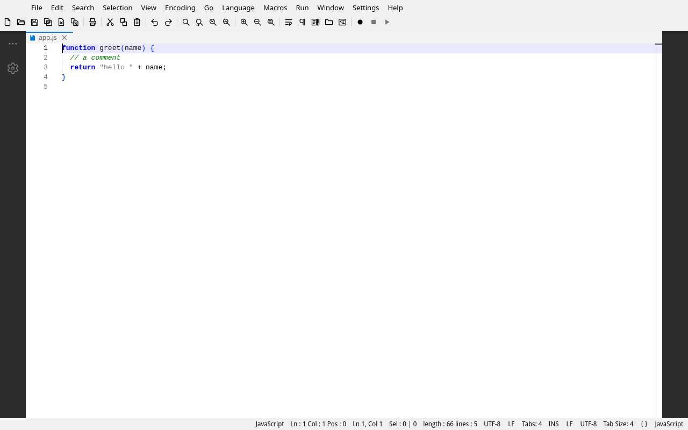
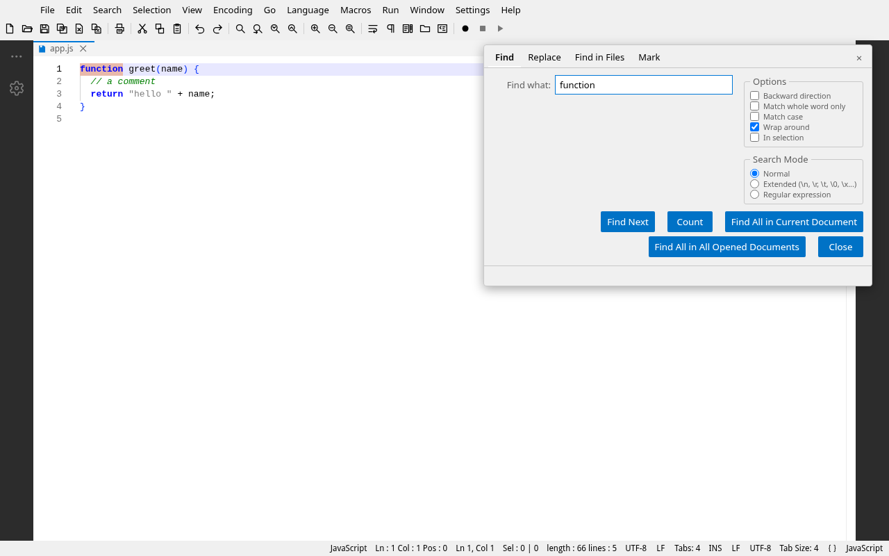
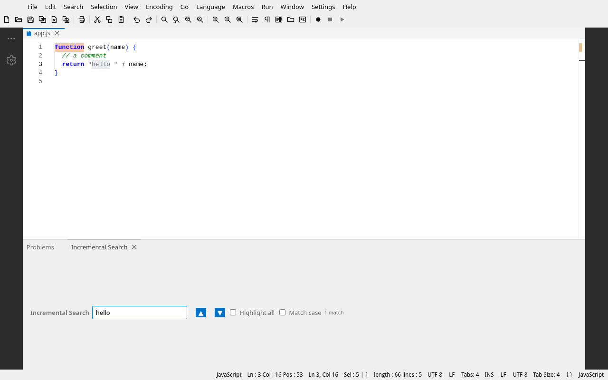
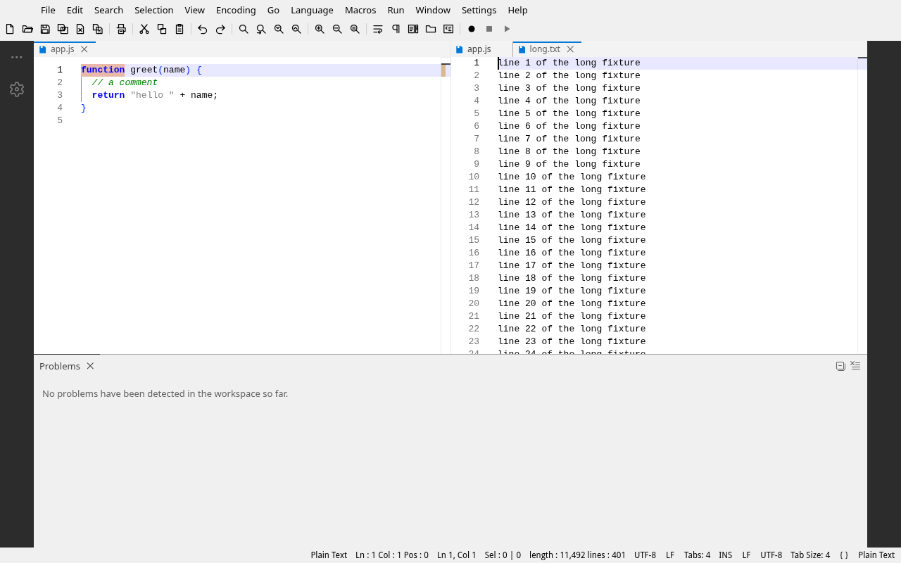

# Notepadia

**Notepadia** is a keyboard-first text editor that reproduces the
[Notepad++](https://notepad-plus-plus.org/) **user experience** — its menus,
shortcuts, editing behavior and window surface — on
[Eclipse Theia](https://theia-ide.org) + Monaco, **without reproducing the
Notepad++ implementation**. It is browser-first (`http://localhost:3000`) and
also packaged as a native desktop application via Electron.

It is not a port, fork or plugin host for Notepad++ and uses no Notepad++ code.
See [About & goals](about.md) for what that distinction means, what is in and
out of scope, and how the docs are organized.

The product is organized as a monorepo:

- `applications/browser` — the web development target, served at
  `http://localhost:3000`.
- `applications/electron` — the native desktop target (Electron +
  electron-builder): NSIS/portable installers on Windows, AppImage/RPM/DEB on
  Linux, DMG on macOS.
- `extensions/notepadia` — the product extension. All Notepad++-style behavior
  lives here and is shared by both application targets.

## Highlights

- A Notepad++-style menu layout: `Search`, `Encoding`, `Language`, `Settings`
  menus plus Npp-style `File`/`Edit` sections.
- One modeless, tabbed Find dialog (Find / Replace / Find in Files / Mark)
  behind Ctrl+F, Ctrl+H, Ctrl+Shift+F and Ctrl+M, replacing Monaco's inline
  find widget, with the Find in Files tab driving workspace search and the
  Mark tab providing the five Notepad++ mark styles.
- A **Search Results window** behind F7 (plus F4/Shift+F4 stepping) that keeps
  the hits of every Find All and Find-in-Files run.
- An **Incremental Search bar** behind Ctrl+Alt+I: live per-keystroke jumping
  with wrap-around, Enter/Shift+Enter stepping, a red-and-announced
  `no match` state, and Escape restoring the caret unless a jump was accepted.
- Notepad++-style shortcuts: Ctrl+D (duplicate line), Ctrl+L (delete line),
  Ctrl+F2 bookmarks, and more.
- Browser-proof shortcuts: the chords a browser claims (`Ctrl+N`, `Ctrl+W`,
  `Ctrl+Shift+W`, `Ctrl+O`, `F5`, `Ctrl+F5`) keep working in the desktop app
  and gain alternates on the web (`Ctrl+Alt+N`, `Ctrl+F4`, `Ctrl+Alt+Shift+W`,
  `Ctrl+Alt+O`, `Ctrl+Alt+D`, `Ctrl+Alt+Shift+D`); editor zoom keeps `Ctrl+=` /
  `Ctrl+-` / `Ctrl+0` to the text while the editor has focus and leaves page
  zoom to the browser elsewhere; `Settings ▸ Shortcut Mapper` lists and
  rebinds every chord.
- The clipboard and selection half of the Edit menu: Copy to Clipboard (path,
  filename, folder), Paste Special (indent, unindent, unformatted), Insert ▸
  Date & Time with a token-based customized box, Select ▸ Begin/End Select and
  Multi-Select All, Line Operations ▸ Column Mode, and a Clipboard History
  panel of the session's last 20 copies.
- `File ▸ Set/Clear Read-Only`: the document refuses edits, the tab shows the
  padlock and the status bar reads `Read-Only` instead of `INS` / `OVR`.
- Encoding conversion (UTF-8, UTF-8 BOM, UTF-16 LE/BE, ANSI, ISO-8859 family).
- EOL conversion (LF / CRLF) with live status-bar display.
- A Notepad++ default behavior profile: on a cold profile the editor starts
  with word wrap off, 4-wide real tabs, no auto-closing brackets/suggestions,
  formatting off, and Notepad++-style `new 1`, `new 2`, ... plaintext untitled
  documents.
- Bookmarks with gutter glyphs and next/previous navigation, plus a Document
  Map (persistent, preference-backed minimap) for the editor.
- The complete Notepad++ View menu: a **Show Symbol** submenu (space/tab,
  end-of-line `¶`, indent guides) driven by Monaco preferences, **Fold All** /
  **Unfold All** / **Fold Level 1-7** (`Alt+0` / `Alt+Shift+0` / `Alt+1`-`Alt+7`),
  a two-pane **Clone** / **Move to Other View** split with **Synchronize
  Vertical / Horizontal Scrolling**, **Full Screen** (`F11`) and **Post-It**
  (`F12`) distraction-free mode, and **Summary...** document statistics.
- Notepad++'s **Window** menu: the first ten open documents numbered from one
  and renumbered as tabs change, and **Windows...**, a multi-select
  `Name`/`Path`/`Type` list with Activate / Save / Close / Sort.
- Notepad++'s **Run** menu: **Run...** expands the `$(FULL_CURRENT_PATH)`,
  `$(FILE_NAME)`, `$(CURRENT_DIRECTORY)`, `$(CURRENT_WORD)` and other run
  variables, opens `http`/`https` commands in a new tab, and says so plainly
  when a command needs the desktop build (where it does launch, behind a
  preference that is off by default). Named commands are listed in the menu and
  managed through **Modify Shortcut/Delete Command...**.
- A full Notepad++ status bar — length/lines, `Ln / Col / Pos`, selection,
  encoding, EOL, indent mode and an `INS`/`OVR` indicator — with a real
  overtype mode toggled by the `Insert` key.
- Curated `Language` menu with lightweight Monarch tokenizers.
- A Notepad++-style 26px toolbar under the menu bar (file, print, clipboard,
  undo/redo, search, zoom, view toggles, macros) with keyboard navigation.
- Notepadia Classic light/dark themes and a Notepad++ window surface (no
  activity bar, no right-hand panel, no breadcrumbs).
- A Notepad++-style tab bar: red/blue floppy saved-dirty icons and a padlock
  for read-only tabs, the Notepad++ right-click tab menu, and middle-click to
  close.
- Recent files with session persistence.
- The four file commands Notepad++ users expect: `Reload from Disk`,
  `Save a Copy As...` (a copy that leaves the tab on the original file),
  `Rename...` (moves the file and keeps the tab on it, carrying unsaved text
  across) and `Delete from Disk` (always confirmed, closes the tab), plus
  `Open Folder as Workspace...` in the `File` menu.
- `Open` means your own disk, everywhere: the `File` menu entry, the toolbar's
  Open button and `Ctrl+O` are one command labeled `Open from Computer`, and
  the server workspace keeps its own differently named entry,
  `Open from Workspace...`. `Save To This Computer...` and
  `Upload to Workspace...` are the bridges between the two, so it is always
  clear which disk a command touches. On Chromium, a file opened from your
  disk keeps its handle and Ctrl+S writes back to that same file.
- Automatic updates over GitHub Releases (desktop app).
- Unsaved work survives a crash: a copy of every document with unsaved changes
  is kept in the browser's own storage a few seconds after you stop typing, and
  restored the next time you open Notepadia. Saving or discarding clears the
  copy, a file that changed on disk in the meantime is never overwritten, and
  `notepadia.backup.enabled` / `notepadia.backup.intervalSeconds` control it.

## Screenshots

The browser build, as it actually runs (captured from a real session by
`scripts/capture-docs-screenshots.mjs`):

**The editor** — Notepad++'s shell: menu bar, toolbar, tab bar with the floppy
saved icon, and the full status bar showing the language, EOL and indent mode:

**The Find dialog** — one modeless dialog with Find, Replace, Find in Files
and Mark tabs, opened by `Ctrl+F`:

**Incremental Search** — the `Ctrl+Alt+I` bar at the foot of the editor,
searching live from the caret:

**Two-pane split** — `View ▸ Move to Other View` with synchronized scrolling,
the way Notepad++ splits a document:

## Project status

Notepadia has completed the Notepad++-experience program (workstreams A–F plus
verification tasks G1–G3 and G5) and shipped its first tagged release,
**2026.10.10**. The remaining open item is **G4**, the demonstration that an
installed desktop build upgrades itself from a published release.

The full milestone history, the workstream status table and the definition of
done live on the [Roadmap](roadmap.md) page.

See [About & goals](about.md) for what "Notepad++ experience, not
implementation" means, [Architecture](architecture.md) for the internal design,
[Accessibility](accessibility.md) for keyboard and screen reader support, and
[Releases & updates](releases.md) for how new builds reach users.